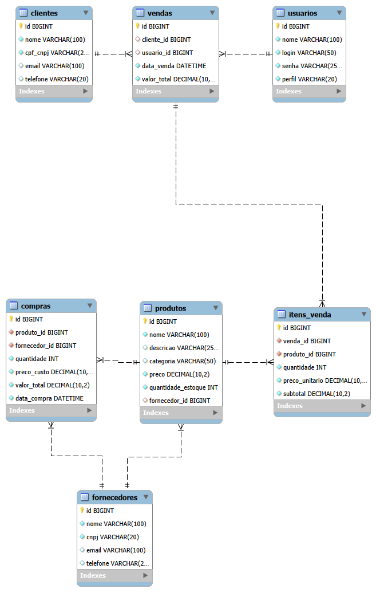

# StockFlow

API REST para controle de estoque e vendas, desenvolvida em **Java com Spring Boot** e banco de dados **MySQL**.

Com ela é possível cadastrar produtos, clientes, fornecedores e usuários, registrar vendas com baixa automática de estoque e proteger as rotas com autenticação via **token JWT**.

## Funcionalidades

- **CRUD completo** de produtos, clientes, fornecedores e usuários
- **Busca de produtos** por nome e por categoria
- **Entrada de estoque** em um produto (`PATCH /produtos/{id}/estoque`)
- **Registro de vendas** com vários itens: a API confere se a quantidade é válida e se há estoque suficiente para cada produto, desconta a quantidade vendida e calcula o total; tudo dentro de uma transação
- **Validação de CPF e CNPJ** no cadastro de clientes e fornecedores
- **Autenticação com JWT**: só o cadastro de usuário e o login são públicos; as demais rotas exigem token
- **Tratamento centralizado de erros** (`GlobalExceptionHandler`), com exceções próprias para estoque insuficiente, registro duplicado e recurso não encontrado
- **Documentação interativa** com Swagger / OpenAPI

## Tecnologias

| Camada | Tecnologia |
|---|---|
| Linguagem | Java 26 |
| Framework | Spring Boot 4 (Web MVC, Data JPA, Security, Actuator) |
| Banco de dados | MySQL + Hibernate/JPA |
| Autenticação | Spring Security + JWT (`java-jwt`) |
| Documentação | springdoc-openapi (Swagger UI) |
| Build | Maven |
| Outros | Lombok |

## Estrutura do projeto

```
src/main/java/com/stockflow
├── controller    # Endpoints REST
├── service       # Regras de negócio (ex.: validação de estoque na venda)
├── repository    # Acesso a dados com Spring Data JPA
├── model         # Entidades: Produto, Cliente, Fornecedor, Usuario, Venda, ItemVenda
├── dto           # Objetos de entrada/saída (login, token)
├── exception     # Exceções personalizadas e handler global
├── util          # Validação de CPF e CNPJ
├── infra/security# Configuração do Spring Security e filtro JWT
└── database      # Script SQL e diagrama entidade-relacionamento
```

## Modelo de dados



## Como executar

**Pré-requisitos:** JDK 26 e MySQL rodando em `localhost:3306`.

1. Clone o repositório:
   ```bash
   git clone https://github.com/Arthuurds/StockFlow-Java.git
   cd StockFlow-Java
   ```
2. Defina as variáveis de ambiente com a senha do banco e a chave do JWT:
   ```bash
   # Linux / macOS
   export DB_PASSWORD=sua_senha_do_mysql
   export JWT_SECRET=uma_chave_longa_e_secreta

   # Windows (PowerShell)
   $env:DB_PASSWORD="sua_senha_do_mysql"
   $env:JWT_SECRET="uma_chave_longa_e_secreta"
   ```
3. Rode a aplicação (o banco `stockflow_db` é criado automaticamente):
   ```bash
   ./mvnw spring-boot:run        # Linux / macOS
   mvnw.cmd spring-boot:run      # Windows
   ```
4. Acesse a documentação em **http://localhost:8080/swagger-ui.html**

## Testes

Os testes automatizados (JUnit 5 + Mockito) cobrem a regra de venda (baixa de estoque, cálculo do total, estoque insuficiente, quantidade inválida, produto inexistente) e a validação de CPF/CNPJ:

```bash
./mvnw test        # Linux / macOS
mvnw.cmd test      # Windows
```

## Endpoints principais

| Método | Rota | Descrição |
|---|---|---|
| POST | `/usuarios` | Cadastra usuário (público) |
| POST | `/login` | Faz login e retorna o token JWT (público) |
| GET / POST | `/produtos` | Lista ou cadastra produtos |
| GET / PUT / DELETE | `/produtos/{id}` | Busca, atualiza ou remove um produto |
| GET | `/produtos/buscar?nome=` | Busca produtos pelo nome |
| GET | `/produtos/categoria/{categoria}` | Lista produtos de uma categoria |
| PATCH | `/produtos/{id}/estoque?quantidade=` | Adiciona quantidade ao estoque |
| GET / POST | `/clientes`, `/fornecedores` | Lista ou cadastra |
| GET / PUT / DELETE | `/clientes/{id}`, `/fornecedores/{id}`, `/usuarios/{id}` | Busca, atualiza ou remove |
| GET / POST | `/vendas` | Lista vendas ou registra uma nova venda |
| GET | `/vendas/{id}` | Detalha uma venda |

Nas rotas protegidas, envie o token no cabeçalho:

```
Authorization: Bearer <seu_token>
```

## Exemplo de uso

```bash
# 1. Login
curl -X POST http://localhost:8080/login \
  -H "Content-Type: application/json" \
  -d '{"login": "admin", "senha": "123456"}'

# 2. Listar produtos com o token recebido
curl http://localhost:8080/produtos -H "Authorization: Bearer SEU_TOKEN"
```

## Autor

**Arthur Dornas**: estudante de Engenharia de Software (PUC Minas) e Técnico em Desenvolvimento de Sistemas (Senac)
[GitHub](https://github.com/Arthuurds) · [LinkedIn](https://www.linkedin.com/in/arthur-dornas-8971663a8/)
